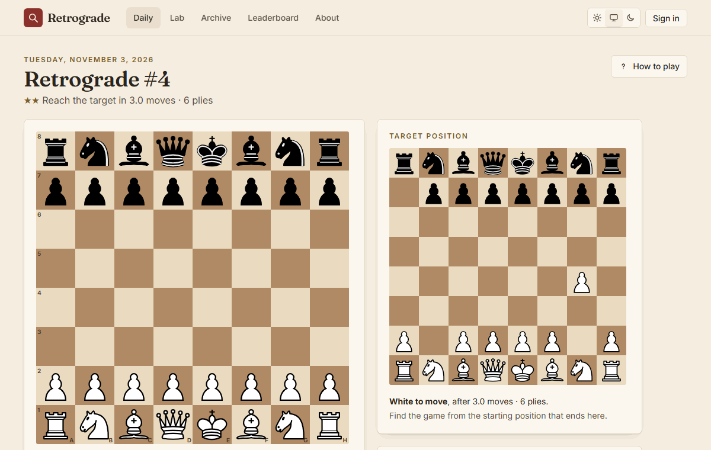
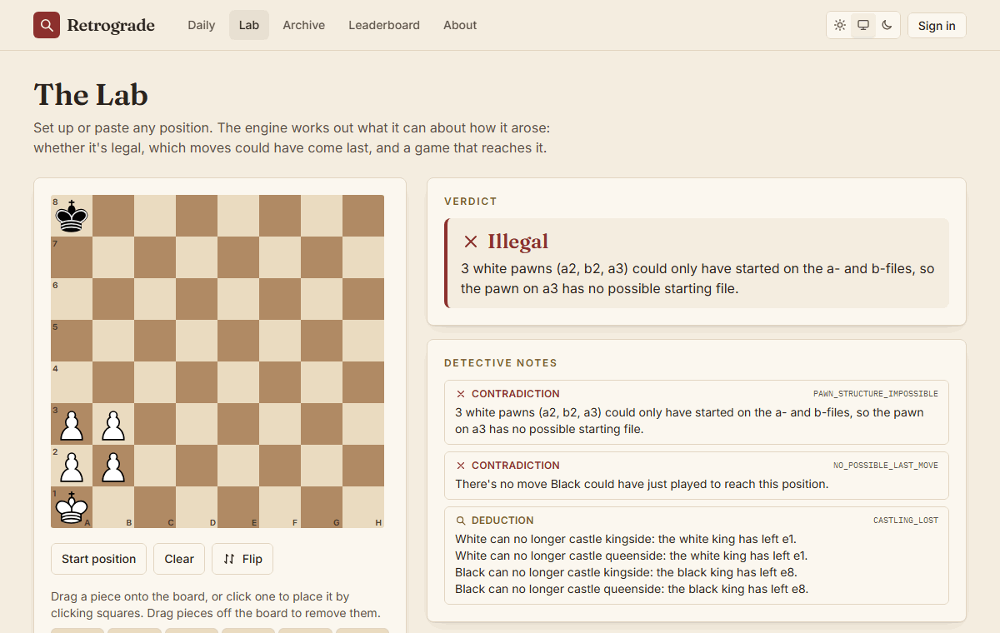
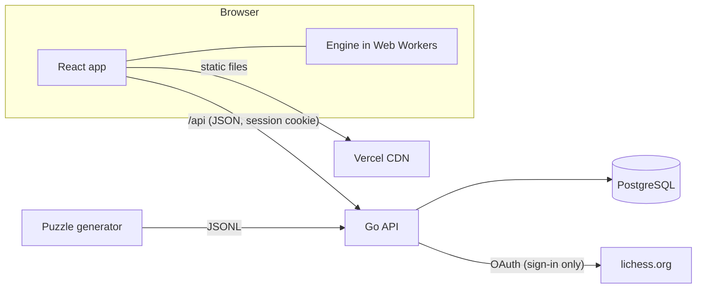

# Retrograde

Chess detective puzzles built on **retrograde analysis**: instead of asking "what's the best move?", Retrograde asks "**what happened?**". Look at a position and reason backwards to work out how it arose.

**Play it: [retrograde-chess.vercel.app](https://retrograde-chess.vercel.app)**

| A daily puzzle | The Lab |
|---|---|
|  |  |

## What it does

- **Daily Proof Game**: a Wordle-style puzzle. Reach the target position from the starting position in exactly N plies. Six guesses, per-ply feedback (right move, right move at another ply, or not in the solution, always with an icon as well as a colour), three hints, streaks, a share card and leaderboards. Every puzzle has exactly one solution, proved by the solver.
- **The Lab**: set up or paste any position. The engine explains in plain English whether it can arise (and why not), lists the moves that could have been played last, and can prove a position legal by finding the shortest game that reaches it. It all runs in your browser.
- **Accounts**: a username and password, or Sign in with Lichess. Guests can play too, and their results move to their account when they sign up.

## Architecture



| Part | What it is |
|---|---|
| [`packages/engine`](packages/engine) | TypeScript chess and retro-analysis engine: move generation, retractions, the static rules and the proof-game solver. No dependencies; runs in the browser and in Node. |
| [`apps/web`](apps/web) | React + Vite. The board is [chessground](https://github.com/lichess-org/chessground); the engine runs in Web Workers. |
| [`apps/generator`](apps/generator) | Node CLI that generates puzzles and proves each one unique, with byte-identical output for a seed. |
| [`services/api`](services/api) | Go + PostgreSQL: accounts, sessions, the daily game (the solution never leaves the server early), leaderboards, Sign in with Lichess. |
| [`api/openapi.yaml`](api/openapi.yaml) | The API contract. The Go server interface, request validation and the TypeScript client types are generated from it. |

The design, with the reasons behind each decision, is in [docs/ARCHITECTURE.md](docs/ARCHITECTURE.md).

## Interesting problems

**Reasoning backwards, soundly.** The retraction generator "un-plays" moves: un-captures, un-promotions, un-castling, un-en-passant. Every candidate is confirmed by generating forward from the prior position, so a reported last move is always real. Property tests check both directions over thousands of random positions: every real last move is found, and nothing found is fake. One subtlety: a FEN that writes `-` for en passant only means "not stated". Many FENs write it right after a double push, so a strict reading would call legal positions illegal.

**Capture accounting is a matching problem.** Every pawn started on its own file, and each file change costs a capture. The minimum number of captures is a minimum-cost assignment of pawns to starting files. With at most 8 pawns it's an exact dynamic program over bitmasks. When no assignment exists at all, a maximum matching and its alternating paths find the group of pawns that breaks Hall's condition, so the Lab can say exactly which pawns can't all have started where they'd need to.

**An admissible bound, and the castling trap.** The solver searches forward from the starting position with a move budget per side, and prunes with a lower bound on the moves each side still needs: per-piece distances matched to target squares, plus the captures each side must make. The bound must never overestimate, or the search silently misses solutions. Castling moves two pieces in one move, so naive distances overestimate; while castling is still possible, the king and rook costs are adjusted so the castling move counts once.

**The promotion hole.** The first version of the bound matched every target piece to a current piece of its type. That overestimates: a white knight far from the target knight's square, while a white pawn is one move from promoting there (the original knight is captured later, which costs White nothing). The true cost is 1; the forced match said 4. Now any target piece may be "a promoted pawn" at no cost, as often as there are spare pawns, per piece type. The admissibility property test plays thousands of random games and asserts that this pattern actually occurs among them.

**Counting to two, fast.** A daily puzzle must have exactly one solution. The solver counts solutions with a transposition table that stores, for each position and remaining length, how many games finish from there, saturated at 2. Repeated subtrees become lookups, so proving uniqueness is cheap. The hash includes the en passant file only when a capture is actually possible, so positions with identical futures share one entry.

**Growing unique puzzles.** Random games are almost never unique beyond about 8 plies, because independent moves can be played in either order. The generator grows puzzles one move at a time instead: if a game is the unique shortest proof of its position, so is its prefix (except when the last move is castling or en passant). Before any search, a free test rejects most candidates in about 0.1 ms: could the last move have been played earlier? Searches are bounded by node counts, never time, so a seed always produces the same 500-puzzle pool on any machine and with any number of threads.

**Checking against an outside source.** The solver's counts are compared with brute-force enumeration of every game up to 5 plies. That enumeration is in turn checked against the published position statistics on [wismuth.com](https://wismuth.com/chess/statistics-positions.html). Their "diagrams" are only the 64 squares, but with exactly N plies from the start the side to move is fixed by parity, so per length they match our target keys.

**One set of chess rules in two languages.** The browser plays with the TypeScript engine, but the server checks guesses with a Go chess library, so the solution never has to leave the server. To keep the two in agreement, the engine generates 652 replay vectors (legal games with castling, en passant and underpromotions, plus games with one illegal move) and the daily-feedback vectors, and a Go test checks every one, including the SAN of every move.

**The board that dropped pieces on the wrong square.** A CI run failed once, then passed. The board library caches the board's position on the page and refreshes it only on scroll and resize, so when a late web font shifted the layout, a drag could land one square off. The fix re-measures on every pointer-down, and a regression test forces a layout shift before dragging.

**The migration that wasn't there.** Every automated test passed, but the first real sign-in with Lichess failed: the development database had never been migrated to the new column. Each test migrates its own fresh schema, so the tests couldn't notice. Now the server refuses to start while any migration is pending and names the fix, and `pnpm dev` applies migrations before it starts.

## Running it locally

Requirements: Node 24 with pnpm, Go, Git and PostgreSQL. Windows, Linux and macOS all work.

```sh
pnpm install
cp .env.example .env      # PowerShell: Copy-Item .env.example .env   cmd.exe: copy .env.example .env
                          # then fill in your PostgreSQL user and password
pnpm seed                 # migrate, load the puzzles and schedule dailies
pnpm dev                  # open http://localhost:5173
```

[docs/RUNNING.md](docs/RUNNING.md) covers everything from a fresh clone, every test command, and a manual test checklist. [docs/DEPLOY.md](docs/DEPLOY.md) describes the hosting (Vercel and Neon, or any container host).

## Tests

```sh
pnpm check       # lint, typecheck, fast tests (TS and Go), golangci-lint
pnpm test:api    # Go integration tests against the test database
pnpm test:e2e    # Playwright end-to-end tests (needs the test database too)
pnpm --filter @retrograde/engine test:slow
```

## License

[GPL-3.0-or-later](LICENSE). The board UI uses [chessground](https://github.com/lichess-org/chessground), which is GPL-3.0. The pieces are Colin M.L. Burnett's set (GPLv2+), as shipped with chessground. [Privacy](https://retrograde-chess.vercel.app/privacy).
